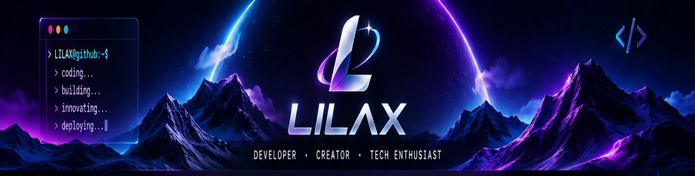
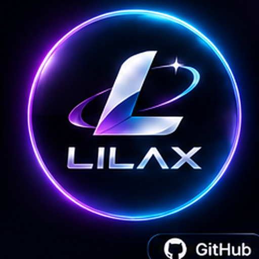

 

  

---

<table>
<tr>
<td width="28%" align="center" valign="middle">
  
</td>
<td width="72%" valign="middle">

## Hi there 👋, I'm CROSSLOX

A developer, creator, and technology enthusiast passionate about building useful tools, modern applications, and exploring new technologies.

  
  
  
  

</td>
</tr>
</table>

## `> About_me`

- 💻 Interested in software development and desktop applications
- ☁️ Exploring cloud tools, automation, and system optimization
- 🎨 Enjoy building clean interfaces and polished user experiences
- 🚀 Always learning, experimenting, and creating

## `> Tech_stack`

---

## `> Github_dashboard`

  

---

## `> Contribution_activity`

  

---

### THINK DIFFERENT · CODE BETTER · BUILD BEYOND

